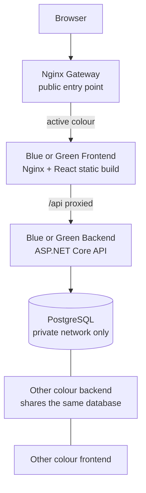
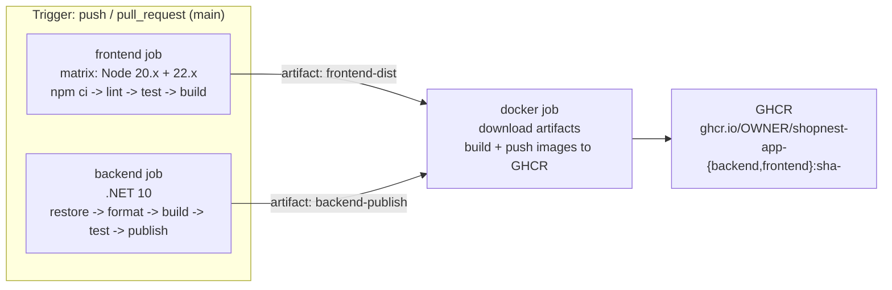

# ShopNest

A production-oriented three-tier e-commerce application built to demonstrate **automated CI/CD, containerization, zero-downtime deployment, and rollback** with GitHub Actions, Docker, and AWS EC2.

> **Live URL:** **Production:** https://shopnest.oxytumzone.com  |  **Staging:** http://shopnest.oxytumzone.com:8080
>
> Deployed on AWS EC2 (Ubuntu 24.04, Docker) through the CD pipeline in this repository. Production is a blue-green deployment with a manual approval gate; staging is deployed automatically after each successful CI run.

---

## 1. Project Overview

ShopNest is a DevOps-focused project. The application is deliberately small — a product catalogue — so that the **delivery pipeline** is the main subject:

- a **React + TypeScript** frontend
- an **ASP.NET Core (.NET 10)** REST API
- a **PostgreSQL** database
- **Nginx** as the single public entry point
- **Docker Compose** running two identical **Blue** and **Green** environments
- **GitHub Actions** CI and CD, with images published to **GHCR**
- **AWS EC2** deployment over SSH
- **Blue-Green** traffic switching with health checks and automatic/manual rollback

### Live demo (local)

```bash
cp .env.example .env      # then set POSTGRES_PASSWORD
docker compose up -d --build
curl http://localhost:8080/api/products
```

Open `http://localhost:8080` for the storefront and `http://localhost:8080/api/info` for build metadata.

## Live Demo (AWS EC2)

| Environment | URL |
|---|---|
| Production | https://shopnest.oxytumzone.com |
| Staging | http://shopnest.oxytumzone.com:8080 |
| Build metadata | https://shopnest.oxytumzone.com/api/info |

---

## 2. Technology Stack

| Layer | Technology |
|---|---|
| Frontend | React 19 + TypeScript + Vite |
| Frontend tests | Vitest + Testing Library |
| Backend | C# / ASP.NET Core Web API (.NET 10) |
| Backend data access | Npgsql + Dapper + SQL migrations |
| Database | PostgreSQL 17 |
| Reverse proxy | Nginx 1.27 |
| Containers | Docker + Docker Compose v2 |
| CI/CD | GitHub Actions |
| Registry | GitHub Container Registry (GHCR) |
| Cloud | AWS EC2 |
| Deployment | Blue-Green with Nginx traffic switching |

---

## 3. Architecture



All traffic enters through **one Nginx gateway** on port 80/443. The gateway proxies to the *active* colour (`blue-frontend` or `green-frontend`). Each frontend container serves the React build and reverse-proxies `/api` to its own backend container. Both colours share the **same PostgreSQL instance**, which is attached only to the private Docker network and has **no published port**.

### Why two full environments?

Blue and Green are two complete, independently deployable copies of the application. A release is deployed to the *inactive* colour, health-checked, and only then does Nginx switch traffic. The previous colour stays running so rollback is an instant upstream change.

---

## 4. Repository Structure

```text
ShopNest/
├── backend/
│   ├── ShopNest.Api/              # ASP.NET Core Web API
│   │   ├── Controllers/           # Products + Health endpoints
│   │   ├── Data/                  # Dapper repository + SQL migration runner
│   │   ├── Models/                # Product entity
│   │   ├── Dtos/                  # ProductDto
│   │   ├── Services/              # ProductService
│   │   └── Program.cs
│   ├── ShopNest.Api.Tests/        # xUnit tests
│   ├── Dockerfile                 # multi-stage production image
│   └── Dockerfile.ci              # image built from CI publish artifact
├── frontend/
│   ├── src/                       # React app (pages, components, api client)
│   ├── nginx/default.conf.template
│   ├── Dockerfile                 # multi-stage build -> Nginx
│   └── Dockerfile.ci
├── database/
│   └── migrations/                # 001_init.sql, 002_seed.sql
├── nginx/
│   └── gateway/default.conf       # public gateway + active upstream
├── scripts/                       # blue-green, rollback, smoke, soak, failure tests
├── docker-compose.yml             # db + blue + green + gateway
├── .github/workflows/
│   ├── ci.yml                     # lint, test, build, publish images
│   └── cd.yml                     # staging + approved production + rollback
├── docs/                          # architecture, deployment, runbooks, evidence
├── .env.example
└── README.md
```

---

## 5. Part A — CI/CD Concepts

### What are CI, Continuous Delivery and Continuous Deployment?

| Term | Meaning |
|---|---|
| **Continuous Integration (CI)** | Developers merge small changes frequently. Every push/PR automatically installs dependencies, lints, tests, and builds. Broken code is detected in minutes, not in production. |
| **Continuous Delivery (CD)** | Every change that passes CI is kept in a **deployable** state. Deployment to production is a **one-click, manually approved** action. The pipeline guarantees the artifact is releasable. |
| **Continuous Deployment** | The same as Continuous Delivery, but the final production deployment is **fully automatic** — no human approval. |

The difference is the **last gate**: Delivery requires a human approval; Deployment removes it.

### How this pipeline fixes the three incidents

| Incident | Root cause | How this pipeline fixes it |
|---|---|---|
| 1. A broken build reached production because nobody ran the tests | No automated quality gate | `ci.yml` runs lint + unit/integration tests + build on every push and PR. The `docker` job only runs after `frontend` and `backend` succeed, and production is only reachable from a successful CI run. |
| 2. The site was down for ~10 minutes on every deployment | Stop-the-world deployment | Blue-Green: the new colour is started and health-checked **before** Nginx switches. The old colour keeps serving during the switch. `nginx -s reload` is graceful, so connections are not dropped. Local soak test: **68 requests, 0 failures** during a switch. |
| 3. Rollback took 2 hours because nobody knew the last good version | Manual, undocumented releases | Every image is tagged with the **commit SHA** (`sha-<7>`). `scripts/rollback.sh [tag] [colour]` switches back to the previous colour immediately, or redeploys any specific tag. GitHub Environments + deployment history record who deployed what. |

### Approach chosen for ShopNest

**Continuous Delivery with a manual production approval gate.**

ShopNest is a small team and the assignment explicitly requires manual approval before production. The pipeline therefore:

- deploys **automatically to staging** after every merge to `main`;
- deploys to **production** through a GitHub Environment that requires a **reviewer**;
- uses **Blue-Green** so the approved release is zero-downtime;
- keeps a **manual rollback** path for any earlier immutable tag.

---

## 6. CI Pipeline (Part B & C)

`ci.yml` runs on **push to `main`** and on **pull requests targeting `main`**.



Key properties required by the assignment:

- **Separate CI and CD workflows** — `ci.yml` and `cd.yml`.
- **Multiple jobs with dependencies** — `docker` has `needs: [frontend, backend]`.
- **Parallel independent work** — frontend and backend run concurrently; the frontend is also a **matrix over Node 20.x and 22.x** (a job tested against more than one runtime version).
- **Build outputs passed between jobs** — `frontend-dist` and `backend-publish` artifacts are uploaded by the build jobs and downloaded by the `docker` job, which builds the runtime images from those exact artifacts (`Dockerfile.ci`).
- **Container images** — pushed to **GHCR** with an immutable `sha-<commit>` tag plus `latest` on `main`.

### Branch protection (required for Part B)

Configure under **Settings → Branches → Branch protection rules → `main`**:

- Require a pull request before merging.
- Require status checks to pass before merging:
  - `Frontend (Node 20.x)`
  - `Frontend (Node 22.x)`
  - `Backend (.NET 10)`
  - `Build and publish container images`
- Require branches to be up to date before merging.
- Do **not** allow force pushes or deletions.

This is a repository setting and cannot be committed as code; it is documented here and in [docs/CI_CD.md](docs/CI_CD.md). See [docs/BRANCHING.md](docs/BRANCHING.md) for the feature-branch + pull-request workflow.

---

## 7. Part D — Secrets and Configuration Management

- No real password, key, or token exists in the repository (only obvious placeholders in `.env.example` and `appsettings.json`). The commit history contains the EC2 public IP in earlier README versions; see [docs/SECURITY_AUDIT.md](docs/SECURITY_AUDIT.md) for the audit and remediation steps.
- `.env` is git-ignored; only `.env.example` (with placeholders) is committed.
- Staging and production use **separate GitHub Environments**, each with its own secrets and variables.
- Production deployment requires a **manual reviewer** in the `production` environment.
- Every secret name and purpose is listed below — **never its value**.

### GitHub Secrets

| Secret | Purpose |
|---|---|
| `EC2_HOST` | Public hostname/IP of the target EC2 instance (staging value in the `staging` environment, production value in `production`). |
| `EC2_USER` | SSH user for the EC2 instance (e.g. `ubuntu`). |
| `EC2_SSH_KEY` | Private SSH key (OpenSSH) with access to the EC2 instance. |
| `GITHUB_TOKEN` | Automatically provided by GitHub Actions; used to log in to GHCR during deployment. |

### GitHub Variables

| Variable | Purpose |
|---|---|
| `APP_DIR` | Path to the repository checkout on EC2 (e.g. `/opt/shopnest`). |
| `STAGING_URL` | Public staging URL used for post-deploy smoke tests. |
| `PRODUCTION_URL` | Public production URL used for post-deploy smoke tests. |
| `EC2_PORT` | Optional SSH port (defaults to `22`). |

### Repository / runtime configuration (`.env.example`)

| Name | Purpose |
|---|---|
| `POSTGRES_DB`, `POSTGRES_USER`, `POSTGRES_PASSWORD` | Database name, user, and password. The password is a required secret. |
| `ASPNETCORE_ENVIRONMENT` | ASP.NET Core environment (`Production` / `Staging`). |
| `APP_VERSION`, `APP_COMMIT` | Build metadata returned by `/api/info` for traceability. |
| `GATEWAY_PORT` | Host port published by the Nginx gateway. |
| `PUBLIC_URL` | Base URL used by scripts and documentation. |
| `REGISTRY`, `IMAGE_TAG`, `BACKEND_IMAGE`, `FRONTEND_IMAGE` | Image coordinates; CI/CD overrides them with SHA tags. |
| `PULL_IMAGES` | `true` to pull from GHCR, `false` for locally built images. |

See [docs/SECRETS.md](docs/SECRETS.md) for the full security model.

---

## 8. Part E — Automated Deployment to AWS EC2

### Architecture

```text
GitHub Actions (ubuntu-latest)
    │  appleboy/ssh-action over SSH
    ▼
AWS EC2 (Ubuntu 22.04/24.04)
    ├── Docker + Docker Compose v2
    ├── /opt/shopnest  (this repository, cloned once)
    │   ├── docker-compose.yml
    │   ├── nginx/gateway/default.conf
    │   └── scripts/
    └── Nginx gateway published on 80/443
          ├── blue-frontend  + blue-backend
          ├── green-frontend + green-backend
          └── PostgreSQL (private Docker network, no public port)
```

### Prerequisites (one-time, on EC2)

```bash
sudo apt-get update
sudo apt-get install -y ca-certificates curl gnupg git
sudo install -m 0755 -d /etc/apt/keyrings
curl -fsSL https://download.docker.com/linux/ubuntu/gpg | \
  sudo gpg --dearmor -o /etc/apt/keyrings/docker.gpg
echo "deb [arch=$(dpkg --print-architecture) signed-by=/etc/apt/keyrings/docker.gpg] \
https://download.docker.com/linux/ubuntu $(. /etc/os-release && echo $VERSION_CODENAME) stable" | \
  sudo tee /etc/apt/sources.list.d/docker.list > /dev/null
sudo apt-get update
sudo apt-get install -y docker-ce docker-ce-cli containerd.io docker-compose-plugin
sudo usermod -aG docker "$USER"

git clone https://github.com/arifuzzaman-hredoy/DevOps-Module-5-Assignment.git /opt/shopnest
cd /opt/shopnest
cp .env.example .env   # set a strong POSTGRES_PASSWORD
```

The database is **not** exposed: `db` has no `ports:` entry in `docker-compose.yml` and is reachable only on the private `app` network. The EC2 security group should allow **80/443** (and **22** restricted to your IP); **5432 must not be open**.

### How deployment happens

1. A push merges to `main` → `ci.yml` runs lint, tests, builds, and pushes `sha-<commit>` images to GHCR.
2. `cd.yml` is triggered by the successful CI run (`workflow_run`).
3. `prepare` resolves the exact commit SHA and image tag.
4. `deploy-staging` SSHes to the staging EC2 host, logs in to GHCR, and runs `scripts/bg-deploy.sh <tag>`, then `scripts/smoke-test.sh`.
5. `deploy-production` uses the **`production` GitHub Environment** (manual reviewer required), then runs the same blue-green deploy against the production host.
6. The deployment is traceable through the image tag (`sha-<commit>`), the `APP_COMMIT` environment variable, `/api/info`, and the GitHub deployment record.

Full step-by-step instructions, including security groups and secrets, are in [docs/DEPLOYMENT.md](docs/DEPLOYMENT.md).

> **Executed:** the pipeline deployed to AWS EC2. Production is live at `https://shopnest.oxytumzone.com` and staging at `http://shopnest.oxytumzone.com:8080`; the production release is a blue-green deployment with a manual approval gate. See CD run [44872809287](https://github.com/arifuzzaman-hredoy/DevOps-Module-5-Assignment/actions/runs/44872809287) and the live `/api/info` endpoint for the deployed commit.

---

## 9. Part F — Zero-Downtime Deployment

### Strategy: Blue-Green with Nginx upstream switching

1. Both `blue` and `green` run the same application definition against one shared PostgreSQL.
2. The new release is deployed to the **inactive** colour.
3. Docker health checks (`/health/ready` on the backend, `/healthz` on the frontend) must pass.
4. Internal smoke tests run through the new colour's own Nginx (`/api/info`, `/api/products`).
5. The gateway upstream is rewritten (`server blue-frontend` ↔ `server green-frontend`) and Nginx is reloaded with `nginx -t && nginx -s reload` — a **graceful** reload that does not drop established connections.
6. A public health check runs through the gateway. If it fails, the script switches back to the previous colour automatically.

### Evidence (actual local run)

A continuous soak test sent a request every 200 ms while `scripts/bg-deploy.sh` switched traffic from **blue to green**:

```text
[INFO] Switching gateway traffic: blue -> green
[ OK ] Public health check passed on 'green'.
[INFO] Blue-Green deployment complete. Active colour: green
[INFO] Soak result: total=68 failures=0
[ OK ] Zero failed requests during the soak window
```

The full log is in [docs/evidence/zero-downtime.md](docs/evidence/zero-downtime.md).

### Trade-offs

| Trade-off | Explanation |
|---|---|
| **Double the runtime footprint** | Both colours run simultaneously. For a small app this is acceptable; sharp cost control would scale the inactive colour down, but that would break instant rollback. |
| **Shared database** | Both colours use one PostgreSQL. Migrations must therefore be **backward compatible** (additive only): new columns/tables, no destructive renames in the same release. This repository's migration runner is idempotent and tracks applied versions. |
| **Stateless requirement** | Blue-Green assumes no in-memory session state. ShopNest is stateless; sticky sessions are not required. |
| **Warm standby** | The previous colour stays running, so rollback is a routing change, not a redeploy. |
| **Nginx reload, not DNS** | DNS switching would introduce caching delays and possible downtime; the gateway reload is immediate. |

---

## 10. Part G — Monitoring, Health Checks and Rollback

### Health endpoints

| Endpoint | Purpose | Failure behaviour |
|---|---|---|
| `GET /health` | Liveness. Does not touch the database. | 200 `{"status":"healthy"}` |
| `GET /health/ready` | Readiness. Opens a PostgreSQL connection. | 200 when ready, **503** when the DB is unreachable |
| `GET /api/info` | Build metadata (`name`, `version`, `commit`). | 200 |
| `GET /healthz` (Nginx) | Cheap gateway/frontend probe. | 200 `ok` |

### Automatic rollback

`scripts/bg-deploy.sh` fails the deployment — and switches back to the previous colour — if:

- the new backend or frontend does not become healthy;
- internal smoke tests fail;
- the public health check fails after the switch.

Demonstrated locally:

```text
[INFO] Switching gateway traffic: green -> blue
[WARN] SIMULATE_FAILURE=post -> failing post-switch verification; rolling back.
[ OK ] Automatic rollback to 'green' completed.
[FAIL] Simulated post-switch failure (rolled back to 'green')
active after:  server green-frontend
[ OK ] All smoke tests passed
```

### Manual rollback to any version

```bash
# Roll back to the previous colour (fastest path)
./scripts/rollback.sh

# Roll back to a specific immutable image tag
./scripts/rollback.sh sha-1a2b3c4 blue
```

Or trigger the **`CD` workflow** with `action = rollback`, `environment = production`, an `image_tag`, and an optional `colour`.

### Logs

- Every deployment prints the target colour, image tags, health checks, and the switch result.
- Container logs: `docker compose logs -f blue-backend green-backend gateway`.
- GitHub Actions keeps the full log of every run, including the exact SHA and image tag.
- `scripts/smoke-test.sh` and `scripts/soak-test.sh` produce readable pass/fail evidence.

---

## 11. Part H — Debugging, Failure Testing and AI-Assisted Development

### Real failures found and fixed during this implementation

These are actual errors encountered while building and validating the project, not hypothetical examples:

| # | Failure | Root cause | Fix |
|---|---|---|---|
| 1 | Backend build: `IServiceCollection does not contain AddOpenApi`, `StatusCodes.StatusServiceUnavailable does not exist` | OpenAPI helper is not available in this project configuration; wrong status-code constant name | Removed the unused OpenAPI registration; changed to `StatusCodes.Status503ServiceUnavailable` |
| 2 | Test build: `CS0747 Invalid initializer member declarator` | Ambiguous object-initializer shorthand (`CreatedAt`) | Rewrote the test with an explicit `CreatedAt = SampleCreatedAt` |
| 3 | Frontend container reported `unhealthy`; `wget: can't connect to remote host` on `localhost` | `localhost` resolved to IPv6 `::1` inside the container, while Nginx listens on IPv4 | Changed health checks and internal probes to `127.0.0.1` |
| 4 | CI failed with `Copy-Item: command not found` | GitHub-hosted runners use Bash; `Copy-Item` is a PowerShell cmdlet | Replaced it with `cp -r ../database/migrations publish/migrations` (commit `cbee38b`) |

Each of these was reproduced locally, diagnosed from the build/container logs, fixed, and re-verified. See [docs/FAILURE_SCENARIOS.md](docs/FAILURE_SCENARIOS.md) and [docs/COPILOT.md](docs/COPILOT.md).

### Deliberate failure scenarios (safe)

`scripts/failure-scenarios.sh` runs against **staging or a local stack only**:

- `bad-image` — deploy a non-existent tag; verify the active colour does **not** change.
- `post-switch-failure` — force a post-switch verification failure; verify automatic rollback.
- `inactive-down` — stop the inactive colour; verify the active colour keeps serving.
- `rollback` — exercise the manual rollback path.

Actual result:

```text
[ OK ] Active colour unchanged (blue); production traffic unaffected
[ OK ] Failure scenario 'bad-image' completed
[ OK ] Active colour 'blue' still serving while 'green' is down
[ OK ] Failure scenario 'inactive-down' completed
```

### AI assistance (Kilo) and GitHub Copilot

The original workflow files were generated with **Kilo**, an AI coding assistant, and then reviewed and corrected. The exact prompts, the generated output, and the manual changes are documented in [docs/COPILOT.md](docs/COPILOT.md).

The prompts in `docs/COPILOT.md` are **reproducible prompts** that can be pasted into **GitHub Copilot Chat**. The original workflows were generated with **Kilo** (an AI coding assistant), not GitHub Copilot; the prompts and the manual changes are documented for reproducibility. Part H is complete based on this AI-assisted workflow generation and the documented failure/fix evidence.

---

## 12. Testing Evidence

All commands below were actually executed locally (Docker Desktop 29.9, .NET 10 SDK image, Node 22).

| Check | Command | Result |
|---|---|---|
| Backend build | `docker build --target build -f backend/Dockerfile .` | ✅ Success |
| Backend tests | `dotnet test ShopNest.sln -c Release` | ✅ **5 passed, 0 failed** |
| Backend formatting | `dotnet format ShopNest.sln --verify-no-changes` | ✅ No changes |
| Frontend lint | `npm run lint` (Linux container) | ✅ 0 errors, 0 warnings |
| Frontend tests | `npm test` (Linux container) | ✅ **6 passed** |
| Frontend build | `npm run build` (Linux container) | ✅ Built in ~2s |
| Workflow lint | `actionlint` | ✅ No issues |
| Compose config | `docker compose config` | ✅ Valid |
| Docker images | `docker compose build` | ✅ Both images built |
| Stack health | `docker compose up -d` | ✅ All services `healthy` |
| Smoke test | `./scripts/smoke-test.sh http://localhost:8080` | ✅ 7/7 checks passed |
| Zero-downtime switch | soak test + `bg-deploy.sh` | ✅ 68 requests, 0 failures |
| Auto rollback | `SIMULATE_FAILURE=post` | ✅ Rolled back, smoke passed |
| Manual rollback | `./scripts/rollback.sh` | ✅ Switched, smoke passed |
| Bad image safety | non-existent tag | ✅ Active colour unchanged |
| **GitHub Actions CI** | push to `main` (run `44880858023`) | ✅ **All jobs green** — Frontend Node 20/22, Backend (.NET 10), images published to GHCR |

CI run: [44880858023](https://github.com/arifuzzaman-hredoy/DevOps-Module-5-Assignment/actions/runs/44880858023) — all jobs green; images in GHCR.
CD run: [44880971914](https://github.com/arifuzzaman-hredoy/DevOps-Module-5-Assignment/actions/runs/44880971914) — staging (26s) and production (26s) deployed successfully with blue-green, after manual approval of the `production` environment.

Detailed logs: [docs/evidence/](docs/evidence/).

---

## 13. Screenshots and Actions History

All 11 required screenshots are committed in [`docs/screenshots/`](docs/screenshots/).

| # | Screenshot | Evidence |
|---|---|---|
| 1 | [01-ci-successful-run.png](docs/screenshots/01-ci-successful-run.png) | CI run [44880858023](https://github.com/arifuzzaman-hredoy/DevOps-Module-5-Assignment/actions/runs/44880858023) |
| 2 | [02-ci-failed-yaml-run.png](docs/screenshots/02-ci-failed-yaml-run.png) | Deliberate YAML failure, run [44884747114](https://github.com/arifuzzaman-hredoy/DevOps-Module-5-Assignment/actions/runs/44884747114) |
| 3 | [03-ci-failed-frontend-test.png](docs/screenshots/03-ci-failed-frontend-test.png) | Deliberate frontend test failure, run [44887207111](https://github.com/arifuzzaman-hredoy/DevOps-Module-5-Assignment/actions/runs/44887207111) |
| 4 | [04-ci-failed-deployment-run.png](docs/screenshots/04-ci-failed-deployment-run.png) | Deliberate staging SSH failure demo, run [44889677627](https://github.com/arifuzzaman-hredoy/DevOps-Module-5-Assignment/actions/runs/44889677627) |
| 5 | [05-cd-staging-success.png](docs/screenshots/05-cd-staging-success.png) | CD run [44883093333](https://github.com/arifuzzaman-hredoy/DevOps-Module-5-Assignment/actions/runs/44883093333) |
| 6 | [06-cd-production-approval.png](docs/screenshots/06-cd-production-approval.png) | Production approval gate, run [44890142542](https://github.com/arifuzzaman-hredoy/DevOps-Module-5-Assignment/actions/runs/44890142542) |
| 7 | [07-cd-production-success.png](docs/screenshots/07-cd-production-success.png) | CD run [44883093333](https://github.com/arifuzzaman-hredoy/DevOps-Module-5-Assignment/actions/runs/44883093333) |
| 8 | [08-blue-green-switch.png](docs/screenshots/08-blue-green-switch.png) | CD run [44883093333](https://github.com/arifuzzaman-hredoy/DevOps-Module-5-Assignment/actions/runs/44883093333) |
| 9 | [09-automatic-rollback.png](docs/screenshots/09-automatic-rollback.png) | Staging automatic-rollback demo; exact output in [docs/evidence/automatic-rollback-staging.md](docs/evidence/automatic-rollback-staging.md) |
| 10 | [10-manual-rollback.png](docs/screenshots/10-manual-rollback.png) | Manual rollback run [44892753441](https://github.com/arifuzzaman-hredoy/DevOps-Module-5-Assignment/actions/runs/44892753441) |
| 11 | [11-workflow-run-history.png](docs/screenshots/11-workflow-run-history.png) | [Actions tab](https://github.com/arifuzzaman-hredoy/DevOps-Module-5-Assignment/actions) showing successful and failed runs |

> Screenshot 4 is from the temporary `CD Failure Demo` workflow ([44889677627](https://github.com/arifuzzaman-hredoy/DevOps-Module-5-Assignment/actions/runs/44889677627)), which simulated a staging SSH connection failure without touching production. Screenshot 9 is from the staging automatic-rollback demo; its terminal output is preserved in [docs/evidence/automatic-rollback-staging.md](docs/evidence/automatic-rollback-staging.md).

---

## 14. Assignment Completion Status

| Part | Topic | Status |
|---|---|---|
| A | CI/CD concepts | ✅ Complete |
| B | Continuous Integration pipeline | ✅ Implemented and verified by GitHub Actions run `44880858023` |
| C | Workflow architecture | ✅ Verified: Node 20/22 matrix, backend job, `docker` dependency, artifacts, GHCR |
| D | Secrets & configuration | ✅ No real secrets committed; raw IP found in history (see [docs/SECURITY_AUDIT.md](docs/SECURITY_AUDIT.md)); staging/production environments, production reviewer and branch protection configured |
| E | Automated deployment to EC2 | ✅ Complete — deployed to AWS EC2 at `https://shopnest.oxytumzone.com` via SSH from GitHub Actions |
| F | Zero-downtime deployment | ✅ Complete — blue-green verified on EC2 (staging 34s, production 26s) |
| G | Monitoring, health checks, rollback | ✅ Complete — health checks, automatic rollback and manual rollback verified |
| H | Debugging & Copilot-assisted development | ✅ Complete — real failures documented; deliberate YAML/test/deployment failures documented with runs and fixes; 11+ screenshots committed; AI-assisted (Kilo) workflow generation prompts and changes documented |
| I | Documentation & repository quality | ✅ Complete — README, docs, 11 screenshots, structure, commits, PR template; PR #1 merged and PR #2/#3 open as evidence |

### Remaining manual tasks

1. **Old repo cleanup**: delete `DevOps-Module-5-Assignment-old` (the previous repo, renamed because the token lacked `delete_repo`).
2. **Keep the server running**: keep EC2 instance `i-0caf589083c6b43cb` running until grading finishes.
3. **Evidence PRs**: PR #2 (YAML failure) and PR #3 (frontend test failure + screenshots) are open and intentionally failing; do not merge them.

---

## 15. License

MIT — see [LICENSE](LICENSE).