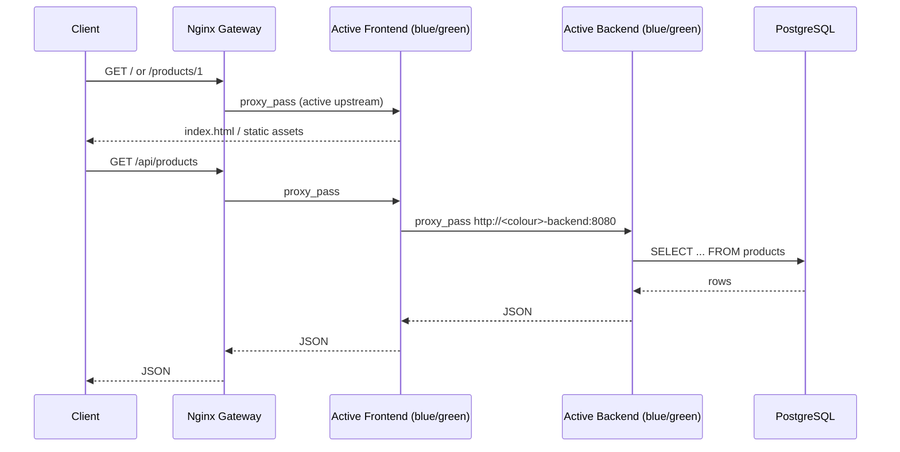

# Architecture

## Components

| Component | Container | Responsibility |
|---|---|---|
| Gateway | `shopnest-gateway` (nginx:1.27-alpine) | Public entry point on port 80/443. Terminates client connections and proxies to the active colour. |
| Blue frontend | `shopnest-blue-frontend` | Serves the React build; proxies `/api` to `blue-backend`. |
| Green frontend | `shopnest-green-frontend` | Serves the React build; proxies `/api` to `green-backend`. |
| Blue backend | `shopnest-blue-backend` | ASP.NET Core API; applies SQL migrations at startup. |
| Green backend | `shopnest-green-backend` | Same image as blue; independent container. |
| Database | `shopnest-db` (postgres:17-alpine) | Shared PostgreSQL. Private network only, persistent volume `pgdata`. |

## Request flow

## Networking

- Docker network `app` (bridge).
- Only `gateway` publishes a host port (`${GATEWAY_PORT}:80`).
- `db` has **no** `ports:` entry — it is not reachable from the host or the internet.
- Frontend and backend containers communicate by service name (`blue-frontend`, `blue-backend`, etc.).

## Why Nginx is the single entry point

- One stable public URL for clients.
- Blue/Green switching is a configuration change inside the gateway, invisible to clients.
- `/api` is proxied by the frontend container so each colour is a self-contained unit; the gateway only needs to know which colour is active.
- TLS termination can be added at the gateway (or an ALB in front of EC2) without touching the application.

## Database compatibility

Both colours share one database. Therefore:

- Migrations are **forward-only and additive**.
- Renames/drops must be split across releases (expand/contract).
- The migration runner records applied files in `__schema_migrations`, so blue and green can start concurrently without double-applying.

## Configuration

All environment-specific values come from `.env` (local/EC2) or GitHub Environment secrets/variables (CI/CD). The application itself reads:

- `ConnectionStrings__Default` — PostgreSQL connection string.
- `Migrations__Path` — directory containing `*.sql` migrations (baked into the image at `/app/migrations`).
- `APP_VERSION`, `APP_COMMIT` — surfaced by `/api/info`.
- `BACKEND_HOST` — used by the frontend Nginx template to proxy `/api`.