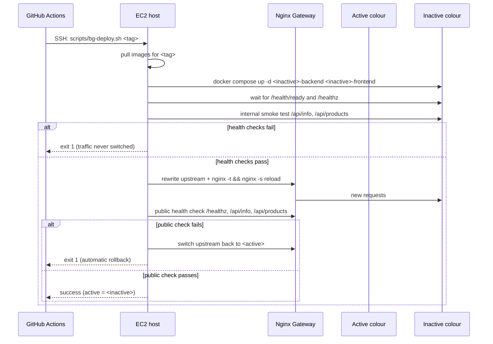

# Blue-Green Deployment

## Model

Two complete environments run side by side:

| Colour | Role |
|---|---|
| **Blue** | One release. At any moment either Blue or Green is *active*. |
| **Green** | The other release. The inactive colour is where the next deployment is staged. |

Both connect to the **same PostgreSQL** instance and use the same image definitions; only the running version differs.

## Deployment sequence



## Implementation details

### Gateway configuration

`nginx/gateway/default.conf` contains a single upstream:

```nginx
upstream shopnest_active {
    server blue-frontend:80;
    keepalive 16;
}
```

Switching is a one-line rewrite:

```bash
sed -i -E "s/server (blue|green)-frontend:80/server green-frontend:80/" \
  nginx/gateway/default.conf
docker compose exec -T gateway nginx -t
docker compose exec -T gateway nginx -s reload
```

`nginx -s reload` is **graceful**: existing worker connections finish, new workers pick up the new upstream. Clients do not see a reset.

### Health gates

1. **Docker health checks** — `docker compose up` only proceeds when dependencies are healthy.
2. **Backend readiness** — `GET /health/ready` returns 503 if PostgreSQL is unreachable.
3. **Frontend probe** — `GET /healthz` returns 200.
4. **Internal smoke test** — through the new colour's own Nginx, not the gateway.
5. **Public smoke test** — through the gateway after the switch.

### Automatic rollback

If any gate after the switch fails, `bg-deploy.sh` rewrites the upstream back to the previous colour and exits non-zero. The previous colour was never stopped, so rollback is a reload, not a redeploy.

### Manual rollback

`scripts/rollback.sh [tag] [colour]` performs the same switch in reverse, optionally after pulling a specific tag.

## Zero-downtime evidence

A soak test (`scripts/soak-test.sh`) sent one request every 200 ms while `bg-deploy.sh` switched Blue → Green:

```text
[INFO] Soak testing http://localhost:8080 for 40s (every 0.2s) ...
[INFO] Switching gateway traffic: blue -> green
[ OK ] Public health check passed on 'green'.
[INFO] Blue-Green deployment complete. Active colour: green
[INFO] Soak result: total=67 failures=0
[ OK ] Zero failed requests during the soak window
```

Full log: [evidence/zero-downtime.md](evidence/zero-downtime.md).

## Trade-offs

| Trade-off | Detail |
|---|---|
| **Cost** | Two full environments run at once. The inactive colour could be stopped to save resources, but that would make rollback slower. |
| **Database coupling** | Both colours share one DB, so migrations must be backward compatible. The runner is forward-only and idempotent. |
| **Statelessness** | No server-side session state; any instance can serve any request. |
| **Cache/connection draining** | Nginx reload drains workers gracefully; very long-lived connections may persist until they close. |
| **Configuration parity** | Blue and Green use the same image and environment variables; only the colour-specific `BACKEND_HOST` differs. |

## Backward-compatible migrations

Safe (expand):

- `CREATE TABLE IF NOT EXISTS ...`
- `ALTER TABLE ... ADD COLUMN IF NOT EXISTS ...`
- `INSERT ... ON CONFLICT DO NOTHING`

Unsafe in a single Blue-Green release (contract):

- Dropping or renaming a column the old colour still reads.
- Adding a `NOT NULL` column without a default.
- Changing a column type incompatibly.

Use expand/contract: add the new shape, deploy, migrate readers, then remove the old shape in a later release.