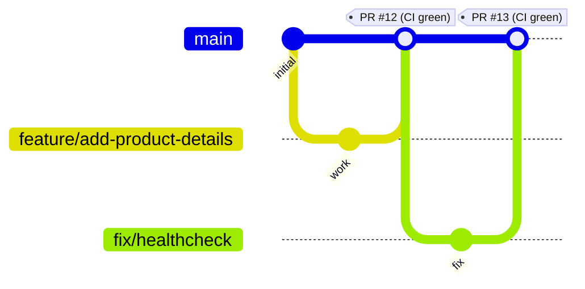

# Branching Workflow

ShopNest uses a lightweight **trunk-based** workflow with short-lived feature branches and mandatory pull requests.



## Rules

| Rule | Detail |
|---|---|
| `main` is always deployable | Merges to `main` trigger `ci.yml`; a successful CI run triggers `cd.yml` to staging. |
| No direct pushes to `main` | Use a branch + pull request (enforced by branch protection). |
| CI must pass | All required checks must be green before merge. |
| Branches are short-lived | `feature/<topic>`, `fix/<topic>`, `docs/<topic>`. |
| PRs are small | One logical change per PR; include tests and docs. |
| Merge strategy | Squash and merge (keeps `main` history readable). |
| Delete branches after merge | Keeps the repository clean. |

## Required status checks

- `Frontend (Node 20.x)`
- `Frontend (Node 22.x)`
- `Backend (.NET 10)`
- `Build and publish container images`

Configure these in **Settings → Branches → Branch protection rules → `main`**.

## Commit messages

Use [Conventional Commits](https://www.conventionalcommits.org/):

```text
feat: add product detail page
fix: use 127.0.0.1 for container health checks
ci: publish sha-tagged images to GHCR
docs: document blue-green rollback
```

## Releases and traceability

- Every merge to `main` produces `sha-<commit>` images in GHCR.
- `/api/info.commit` reports the running commit.
- Rollback uses an earlier `sha-<commit>` tag.

## Example PR flow

```bash
git switch -c feature/product-search
# make changes, run tests
git add .
git commit -m "feat: add product search"
git push -u origin feature/product-search
gh pr create --fill
# wait for CI, merge with squash
```