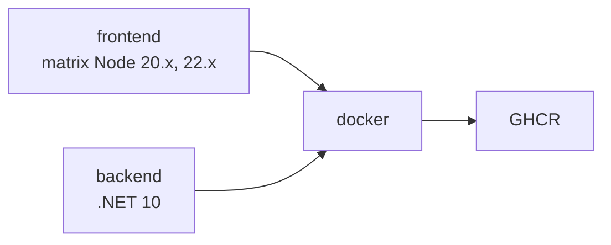
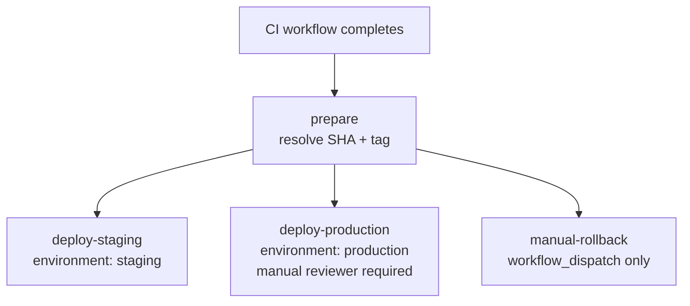

# CI/CD Workflow Reference

## Files

| File | Trigger | Purpose |
|---|---|---|
| `.github/workflows/ci.yml` | `push` to `main`, `pull_request` to `main` | Lint, test, build, and publish images. |
| `.github/workflows/cd.yml` | `workflow_run` after successful CI, or manual `workflow_dispatch` | Deploy to staging, approved production deploy, manual rollback. |

## CI jobs



### `frontend`

- Matrix: **Node 20.x and 22.x** (satisfies the "more than one runtime version" requirement).
- `npm ci` → `npm run lint` → `npm test` → `npm run build`.
- The 22.x leg uploads `frontend-dist` (the `dist/` folder) as an artifact.

### `backend`

- .NET 10 SDK.
- `dotnet restore` → `dotnet format --verify-no-changes` (lint) → `dotnet build` → `dotnet test` (TRX + coverage) → `dotnet publish`.
- Copies `database/migrations` into the publish output and uploads `backend-publish`.

### `docker`

- `needs: [frontend, backend]`, so it runs only after both succeed.
- Downloads `frontend-dist` and `backend-publish` — **build outputs are passed between jobs**.
- Builds `frontend/Dockerfile.ci` and `backend/Dockerfile.ci` from those artifacts.
- On `push` to `main`: logs in to GHCR and pushes:
  - `ghcr.io/<owner>/shopnest-backend:sha-<short>`
  - `ghcr.io/<owner>/shopnest-frontend:sha-<short>`
  - plus `latest`.
- On pull requests: builds only, no push.

## CD jobs



### `prepare`

Resolves the exact commit to deploy:

- `workflow_run` → `github.event.workflow_run.head_sha`
- manual dispatch → `github.sha`

Outputs `short_sha` and `image_tag = sha-<short>`.

### `deploy-staging`

Runs automatically after CI on `main`. SSHes to the staging EC2 host and runs:

```bash
cd "$APP_DIR"
docker login ghcr.io ...
export APP_COMMIT="$COMMIT_SHA" APP_VERSION="$IMAGE_TAG" PULL_IMAGES=true
./scripts/bg-deploy.sh "$IMAGE_TAG"
./scripts/smoke-test.sh "$TARGET_URL"
```

### `deploy-production`

Identical to staging but uses the **`production` GitHub Environment**. Add required reviewers in:

**Settings → Environments → production → Required reviewers**.

The job pauses until a reviewer approves, then runs the blue-green deployment and smoke tests.

### `manual-rollback`

Triggered only by `workflow_dispatch` with:

- `action = rollback`
- `environment = production`
- `image_tag = sha-<commit>` (required)
- `colour = auto | blue | green` (optional)

Runs `scripts/rollback.sh <tag> <colour>` and smoke-tests the result.

## Security notes

- Secrets are passed to `appleboy/ssh-action` through its `envs:` input, not interpolated into the remote script text.
- `GITHUB_TOKEN` is used only to log in to GHCR for the duration of the job.
- If you prefer not to pass the ephemeral token to EC2, make the GHCR packages public or create a dedicated `GHCR_PAT` secret with `read:packages`.

## Branch protection

Required status checks on `main`:

- `Frontend (Node 20.x)`
- `Frontend (Node 22.x)`
- `Backend (.NET 10)`
- `Build and publish container images`

Also enable "Require a pull request before merging" and "Require branches to be up to date before merging".